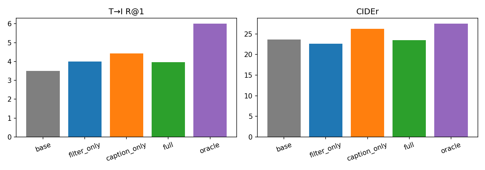
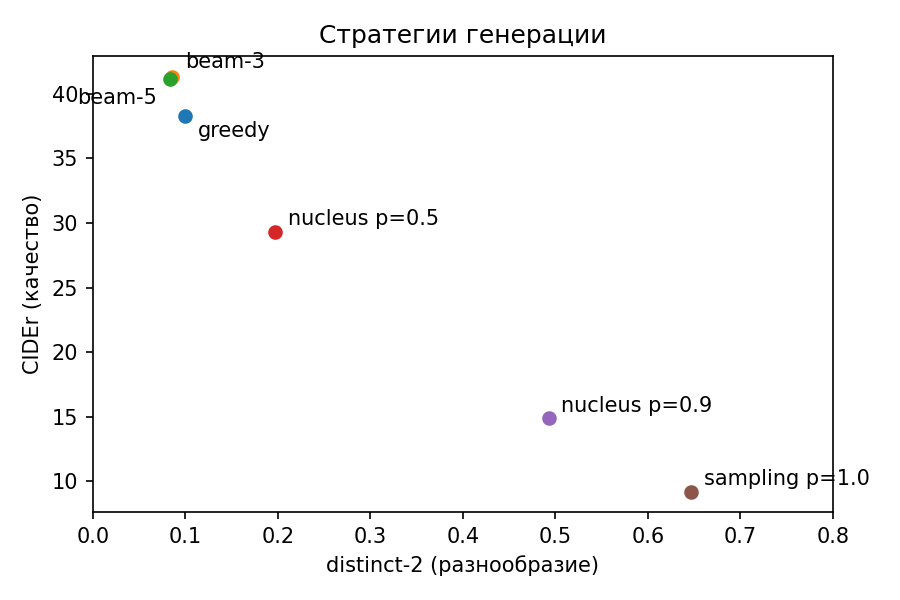
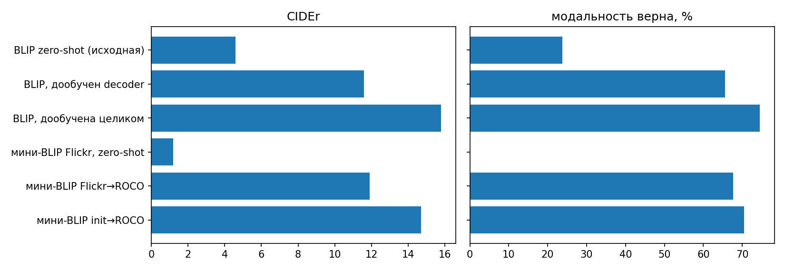

# Mini-BLIP

Уменьшенная версия модели BLIP ([Li et al., 2022](https://arxiv.org/abs/2201.12086)), написанная с нуля на PyTorch. Модель обучена на 5 000 картинках из Flickr30k и умеет искать картинки по тексту и генерировать подписи к ним. Дополнительно модель перенесена на медицинские снимки (датасет ROCO).

## Что сделано

- Реализованы ViT, текстовый энкодер и декодер, три лосса BLIP (ITC, ITM, LM), momentum-энкодеры с очередью негативов, hard negatives для ITM и генерация (greedy, beam search, nucleus sampling). Репозиторий [salesforce/BLIP](https://github.com/salesforce/BLIP) использовался только как образец.
- Размер модели: ViT-S/16 (инициализация весами DeiT) и текстовый трансформер на 6 слоёв, размерность 384.
- Проведены четыре эксперимента: обучение модели, CapFilt, стратегии генерации и дообучение на медицинских снимках.

## Как устроена BLIP

Картинку обрабатывает Vision Transformer, подпись — текстовый трансформер. Модель обучается сразу на трёх задачах:

| Лосс | Что делает |
|---|---|
| ITC (image-text contrastive) | сближает векторы картинки и её подписи и отталкивает чужие, как в CLIP |
| ITM (image-text matching) | решает, подходит ли подпись к картинке |
| LM (language modeling) | генерирует подпись слово за словом |

Во втором и третьем случае текст смотрит на картинку через cross-attention.

## 1. Обучение на Flickr30k

Модель обучалась 8 эпох на 5 000 картинках (по 5 подписей у каждой). Тест — 1 000 картинок.


| | Текст → картинка R@1 / R@5 / R@10 | Картинка → текст R@1 / R@5 / R@10 | BLEU-4 | CIDEr |
|---|---|---|---|---|
| До обучения | 0.1 / 0.5 / 1.1 | 0.0 / 0.4 / 1.0 | 0.0 | 0.0 |
| После обучения | 18.4 / 42.6 / 55.1 | 21.0 / 49.5 / 63.5 | 21.7 | 41.3 |

R@K — доля запросов, для которых правильный ответ оказался в первых K результатах. BLEU и CIDEr показывают, насколько сгенерированная подпись похожа на подписи, написанные людьми.

Примеры подписей до и после обучения: [captions_before_after.png](results/figures/examples/captions_before_after.png).

## 2. CapFilt

В статье BLIP шумные подписи из интернета очищают так: captioner генерирует новые подписи, а filter (ITM) удаляет неподходящие. Мы сымитировали это: 1 000 картинок с чистыми подписями и 4 000 «веб-подписей», из которых 40% заменены подписями от других картинок. На каждом варианте данных модель обучалась с нуля.



| Данные | Пар | Текст → картинка R@1 | Картинка → текст R@1 | CIDEr |
|---|---|---|---|---|
| base: без очистки | 9 000 | 3.5 | 6.0 | 23.6 |
| filter_only: только фильтр | 5 861 | 4.0 | 4.8 | 22.6 |
| caption_only: только captioner | 13 000 | 4.4 | 6.7 | 26.2 |
| full: фильтр + captioner | 6 325 | 4.0 | 4.1 | 23.5 |
| oracle: данные без шума | 9 000 | 6.0 | 8.0 | 27.4 |

- Фильтр отличает шумные подписи с ROC-AUC 0.86.
- Лучший результат дал captioner.
- Полный CapFilt почти не помог. Вероятная причина — строгий порог фильтра (0.5): он удаляет 95% шума, но вместе с ним и 2/3 чистых подписей.

## 3. Стратегии генерации

Одна и та же модель, разные способы выбора следующего слова.



| Стратегия | BLEU-4 | CIDEr | distinct-2 |
|---|---|---|---|
| greedy | 19.8 | 38.3 | 0.10 |
| beam-3 | 21.7 | 41.3 | 0.09 |
| beam-5 | 21.8 | 41.1 | 0.08 |
| nucleus p=0.5 | 15.7 | 29.3 | 0.20 |
| nucleus p=0.9 | 7.3 | 14.9 | 0.49 |
| sampling p=1.0 | 5.2 | 9.2 | 0.65 |

Beam search даёт самые точные подписи, sampling — самые разнообразные, но качество при этом сильно падает. Примеры: [generation_strategies.png](results/figures/examples/generation_strategies.png).

## 4. Медицинские снимки

Повторение статьи [MedBLIP (Limbu & Banerjee, 2025)](https://arxiv.org/abs/2505.14726) на подвыборке ROCO: 3 000 снимков для обучения, 500 для теста. Сравнивались исходная BLIP (`Salesforce/blip-image-captioning-base`) с разными вариантами дообучения и наша мини-BLIP.



| Модель | CIDEr | BERTScore-Bio | Модальность верна, % | Анатомия верна, % |
|---|---|---|---|---|
| BLIP без дообучения | 4.6 | 58.3 | 24 | 26 |
| BLIP, дообучен декодер | 11.6 | 63.8 | 66 | 60 |
| BLIP, дообучена целиком | 15.8 | 64.8 | 74 | 73 |
| мини-BLIP без дообучения | 1.2 | 55.2 | 0 | 0 |
| мини-BLIP: Flickr → ROCO | 11.9 | 62.8 | 68 | 54 |
| мини-BLIP: сразу на ROCO | 14.7 | 64.0 | 70 | 62 |

Модальность и анатомия проверялись автоматически по ключевым словам в подписи.

- Лучше всего работает дообучение всей модели, как и в статье.
- Мини-BLIP почти догнала исходную BLIP по CIDEr (14.7 против 15.8).
- Предобучение на Flickr не помогло.
- После дообучения BLIP чаще описывает находки, которых нет в эталоне: 41% подписей против 1% до дообучения. Примеры ошибок: [medical_errors.png](results/figures/examples/medical_errors.png).

## Как запустить

Нужен Python 3.11 и [uv](https://docs.astral.sh/uv/).

```bash
git clone <ссылка на репозиторий>
cd mini-blip
uv sync
uv run --with jupyter jupyter lab notebooks/01_mini_blip_flickr.ipynb
```

В первой ячейке ноутбука поставьте `QUICK = True`: весь пайплайн пройдёт на мини-данных примерно за 10 минут.
Для полного обучения нужен `QUICK = False` и GPU. Можно запускать и в Google Colab (GPU T4).

Подробная инструкция для Mac — в [docs/SETUP.md](docs/SETUP.md).

## Данные

Подвыборки Flickr30k и ROCO скачиваются автоматически с Hugging Face.
Медицинский ноутбук использует модель из первого, поэтому сначала запустите `01`.

## Структура репозитория

```
mini-blip/
├── notebooks/
│   ├── 01_mini_blip_flickr.ipynb   эксперименты 1–3
│   └── 02_medical_roco.ipynb       эксперимент 4
├── results/
│   ├── tables/                     итоговые таблицы (csv)
│   ├── figures/                    графики
│   └── logs/                       логи обучения (json)
├── scripts/make_figures.py         построение графиков
├── docs/
│   ├── SETUP.md                    установка
│   └── presentation.pdf            презентация
└── pyproject.toml, uv.lock
```

Чекпоинты и данные в репозиторий не входят.

## Ограничения

- Модель и данные маленькие (5 000 картинок вместо 14 млн в статье), поэтому числа намного ниже, чем у оригинальной BLIP.
- BLEU и CIDEr считаются через `pycocoevalcap` с упрощённой токенизацией.
- В медицинской части клиническая правильность оценивалась автоматически, а не врачом.
- Каждый вариант обучался с одним сидом, поэтому небольшие различия могут быть шумом.

## Ссылки

- Li et al. *BLIP: Bootstrapping Language-Image Pre-training for Unified Vision-Language Understanding and Generation*, ICML 2022 — [arXiv:2201.12086](https://arxiv.org/abs/2201.12086)
- [salesforce/BLIP](https://github.com/salesforce/BLIP)
- Limbu & Banerjee. *MedBLIP: Fine-tuning BLIP for Medical Image Captioning*, 2025 — [arXiv:2505.14726](https://arxiv.org/abs/2505.14726)
- [Flickr30k на Hugging Face](https://huggingface.co/datasets/nlphuji/flickr30k)
