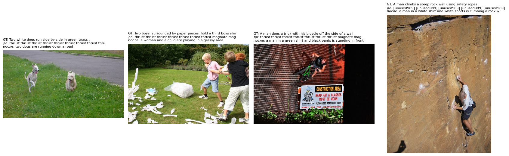
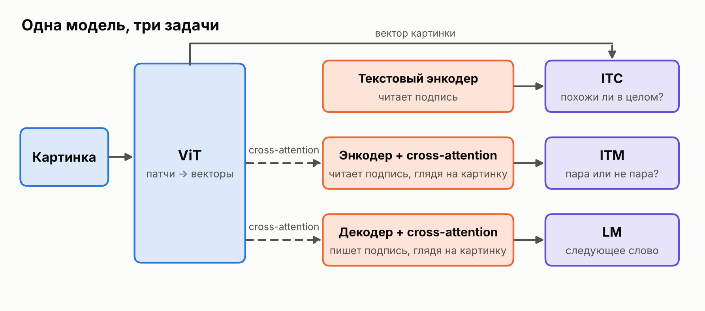
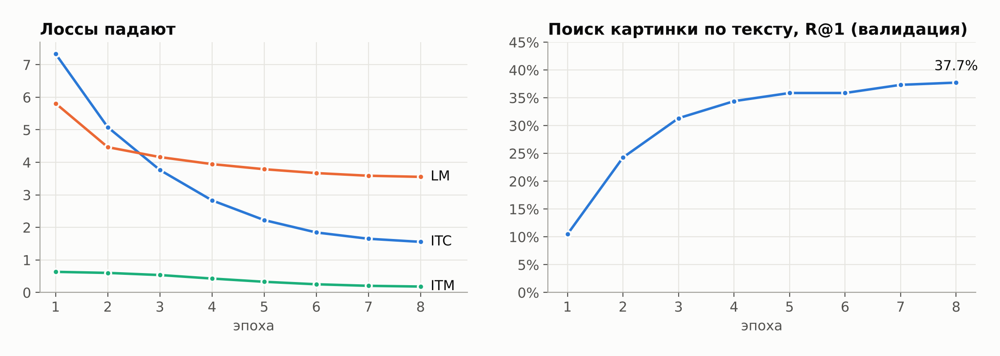
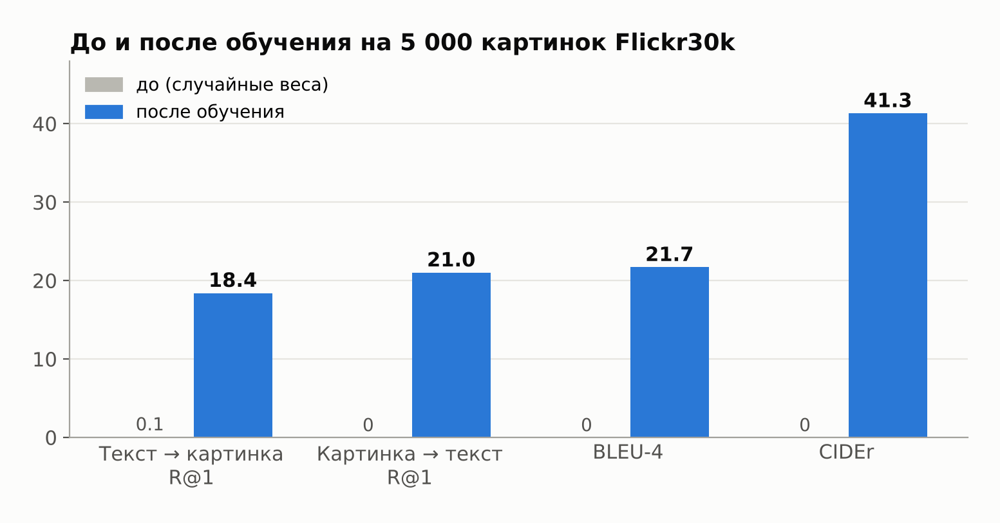
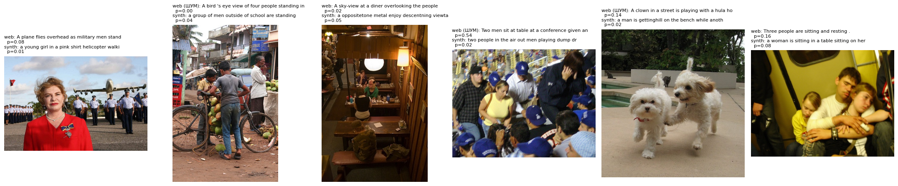
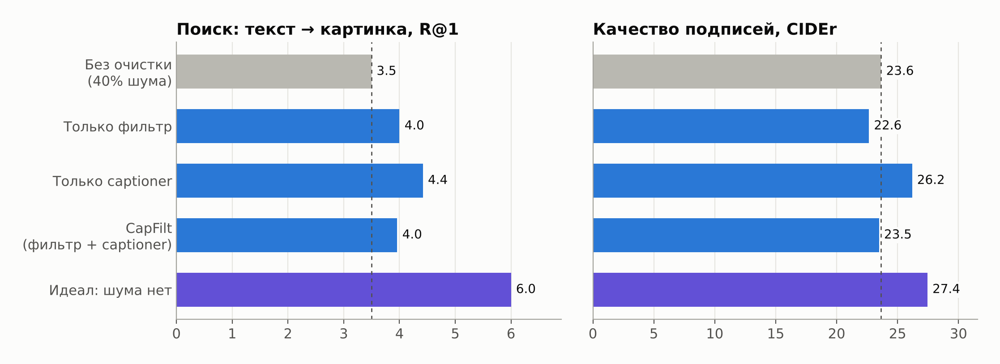
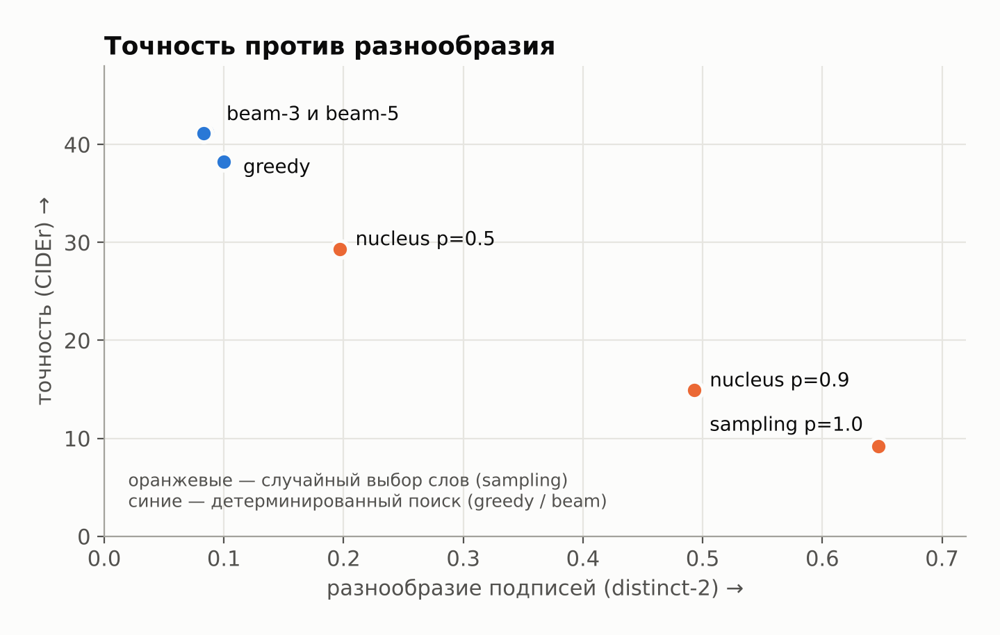
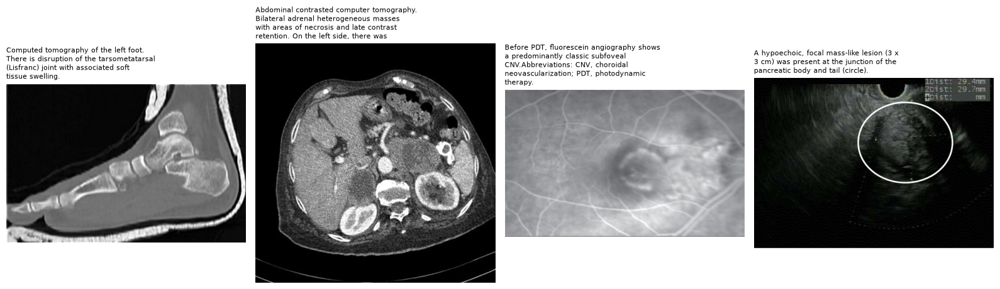
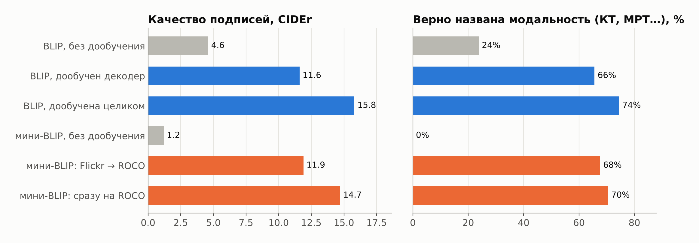

# Mini-BLIP: модель, которая ищет картинки по тексту и пишет к ним подписи

Уменьшенная копия модели **BLIP** ([Li et al., 2022](https://arxiv.org/abs/2201.12086)), написанная **с нуля на PyTorch** и обученная на 5 000 картинках из Flickr30k, а затем перенесённая на медицинские снимки. Модель умеет две вещи:

- 🔍 **искать**: по фразе «две собаки бегут по траве» найти подходящую картинку (и наоборот);
- ✍️ **описывать**: сама придумать подпись к фотографии.

<p align="center">
  
  <br><sub>Подписи до обучения (бессмыслица) и после: «two dogs are running down a road», «a man in a white shirt … is climbing a rock».</sub>
</p>

---

## Содержание

1. [Как устроена BLIP — за минуту](#1-как-устроена-blip--за-минуту)
2. [Что сделано](#2-что-сделано)
3. [Эксперимент 1. До и после обучения](#3-эксперимент-1-до-и-после-обучения)
4. [Эксперимент 2. CapFilt: очистка шумных данных](#4-эксперимент-2-capfilt-очистка-шумных-данных)
5. [Эксперимент 3. Как генерировать подписи](#5-эксперимент-3-как-генерировать-подписи)
6. [Эксперимент 4. Медицинские снимки (MedBLIP)](#6-эксперимент-4-медицинские-снимки-medblip)
7. [Как запустить](#7-как-запустить)
8. [Структура репозитория](#8-структура-репозитория)
9. [Ограничения](#9-ограничения)

---

## 1. Как устроена BLIP — за минуту

Картинку режем на маленькие квадратики (патчи), и **Vision Transformer (ViT)** превращает их в векторы. Три текстовые ветки читают подпись, и две из них через **cross-attention** «подглядывают» в векторы картинки. Ветки во многом делят общие веса, поэтому это одна модель, которая учится сразу трём задачам:



| Задача (лосс) | Что делает | Зачем |
|---|---|---|
| **ITC** — image-text contrastive | Сближает векторы картинки и её подписи, отталкивает чужие (как в CLIP) | Быстрый поиск |
| **ITM** — image-text matching | Внимательно смотрит на пару и отвечает «подходит / не подходит» | Точная проверка и фильтр шума |
| **LM** — language modeling | Пишет подпись слово за словом, глядя на картинку | Генерация подписей |

Главная идея статьи — **CapFilt**: в интернете подписи к картинкам часто мусорные. BLIP сама себе чистит данные: *captioner* (LM) пишет новые подписи, а *filter* (ITM) выкидывает неподходящие.

## 2. Что сделано

- **Модель написана с нуля**: ViT, текстовый энкодер и декодер, все три лосса, momentum-энкодеры с очередью негативов, hard negatives для ITM, генерация (greedy / beam search / nucleus). Репозиторий [salesforce/BLIP](https://github.com/salesforce/BLIP) использовался только как образец.
- **Размер**: ViT-S/16 (стартует с ImageNet-весов DeiT) + текстовый трансформер на 6 слоёв, размерность 384. Помещается на одну GPU T4, эпоха около 4 минут.
- **Данные**: Flickr30k (разбиение Karpathy): 5 000 картинок для обучения (по 5 подписей у каждой), 300 для валидации, 1 000 для теста.
- **Четыре эксперимента**: до/после обучения, CapFilt, стратегии генерации и перенос на медицинские снимки.

## 3. Эксперимент 1. До и после обучения

Сравниваем модель со случайными весами и модель после 8 эпох обучения на всех трёх задачах.





| | Текст → картинка R@1 / R@5 / R@10 | Картинка → текст R@1 / R@5 / R@10 | BLEU-4 | CIDEr |
|---|---|---|---|---|
| До обучения | 0.1 / 0.5 / 1.1 | 0.0 / 0.4 / 1.0 | 0.0 | 0.0 |
| **После обучения** | **18.4 / 42.6 / 55.1** | **21.0 / 49.5 / 63.5** | **21.7** | **41.3** |

R@1 — в скольких процентах случаев правильная картинка оказалась первой в выдаче из 1 000. BLEU и CIDEr — насколько сгенерированная подпись похожа на подписи, написанные людьми.

**Вывод:** модель с нуля научилась и искать, и описывать. Правильная картинка в топ-10 выдачи оказывается в 55% случаев, а подписи выходят осмысленными.

## 4. Эксперимент 2. CapFilt: очистка шумных данных

**Как имитировали интернет.** 1 000 картинок считаем размеченными людьми (чистые подписи). Ещё к 4 000 подписей добавили шум, 40% из них подменили подписями от чужих картинок. 
Далее обучали модель с нуля на пяти вариантах данных.

<p align="center">
  
  <br><sub>Примеры: веб-подпись, подпись от captioner'а и вероятность «пара подходит» по мнению фильтра (p).</sub>
</p>



| Данные для обучения | Пар | Текст → картинка R@1 | Картинка → текст R@1 | CIDEr |
|---|---|---|---|---|
| Без очистки (40% шума) | 9 000 | 3.5 | 6.0 | 23.6 |
| Только фильтр | 5 861 | 4.0 | 4.8 | 22.6 |
| Только captioner (добавили синтетику) | 13 000 | **4.4** | **6.7** | **26.2** |
| CapFilt (фильтр + captioner) | 6 325 | 4.0 | 4.1 | 23.5 |
| Идеал: шума нет совсем | 9 000 | 6.0 | 8.0 | 27.4 |

**Что получилось:**
- Фильтр (ITM) неплохо отличает шум: ROC-AUC = 0.86.
- Лучше всего помог captioner: синтетические подписи подняли и поиск, и качество подписей.
- Полный CapFilt почти не помог. Вероятная причина в слишком строгом пороге фильтра (0.5): он убирает 95% шума, но заодно выбрасывает 2/3 хороших подписей, и данных становится мало. На маленькой модели и маленьком датасете эффект статьи воспроизводится лишь частично.

## 5. Эксперимент 3. Как генерировать подписи

Одна и та же обученная модель, но разные способы выбирать следующее слово:

- **greedy** — всегда самое вероятное слово;
- **beam search** — держит 3–5 лучших вариантов фразы;
- **nucleus / sampling** — выбирает слово случайно среди вероятных.



| Стратегия | BLEU-4 | CIDEr | Разнообразие (distinct-2) |
|---|---|---|---|
| greedy | 19.8 | 38.3 | 0.10 |
| **beam-3** | 21.7 | **41.3** | 0.09 |
| beam-5 | **21.8** | 41.1 | 0.08 |
| nucleus p=0.5 | 15.7 | 29.3 | 0.20 |
| nucleus p=0.9 | 7.3 | 14.9 | 0.49 |
| sampling p=1.0 | 5.2 | 9.2 | **0.65** |

**Вывод:** beam search даёт самые точные, но однообразные подписи. Случайный выбор слов делает подписи разнообразнее, но они быстро превращаются в бессмыслицу. Примеры всех стратегий на одних и тех же картинках — [здесь](results/figures/examples/generation_strategies.png).

## 6. Эксперимент 4. Медицинские снимки (MedBLIP)

Повторили идею статьи [MedBLIP (Limbu & Banerjee, 2025)](https://arxiv.org/abs/2505.14726): что будет, если научить BLIP описывать **рентген, КТ, МРТ и УЗИ**? Данные — радиологическая часть датасета **ROCO** (3 000 снимков для обучения, 500 для теста, у каждого одна подпись из научной статьи).

<p align="center">
  
  <br><sub>Так выглядят данные: снимок и подпись к нему из научной статьи.</sub>
</p>

Сравнили два вида моделей:
- **настоящая BLIP** (`Salesforce/blip-image-captioning-base`): без дообучения, с дообученным только декодером и дообученная целиком;
- **наша мини-BLIP**: модель с Flickr, дообученная на ROCO, и для контроля та же модель, обученная сразу на ROCO.



| Модель | CIDEr | BERTScore-Bio | Модальность верна, % | Анатомия верна, % |
|---|---|---|---|---|
| BLIP, без дообучения | 4.6 | 58.3 | 24 | 26 |
| BLIP, дообучен декодер | 11.6 | 63.8 | 66 | 60 |
| **BLIP, дообучена целиком** | **15.8** | **64.8** | **74** | **73** |
| мини-BLIP, без дообучения | 1.2 | 55.2 | 0 | 0 |
| мини-BLIP: Flickr → ROCO | 11.9 | 62.8 | 68 | 54 |
| мини-BLIP: сразу на ROCO | 14.7 | 64.0 | 70 | 62 |

*Модальность и анатомию проверяли автоматически: искали в подписи слова вроде «CT», «MRI», «chest», «brain» и сравнивали с эталоном.*

**Что получилось:**
- Без дообучения обе модели «не видят» медицину: обычная BLIP описывает снимок как «an x-ray image of a man's chest» даже для КТ головы. После дообучения модальность угадывается в 3 раза чаще (24% → 74%), и **лучше всего работает дообучение всей модели**, как и в статье.
- Наша маленькая модель, написанная с нуля и без предобучения на миллионах картинок, почти догнала большую BLIP (CIDEr 14.7 против 15.8).
- Предобучение на Flickr **не помогло**: модель, обученная сразу на ROCO, оказалась лучше. Обычные фотографии слишком далеки от медицинских снимков.
- **Обратная сторона дообучения — галлюцинации.** Дообученная BLIP начинает уверенно описывать находки, которых нет в эталоне: такие подписи выросли с 1% до 41%. Модель выучила *стиль* медицинских подписей быстрее, чем их *содержание*. [Примеры ошибок по категориям](results/figures/examples/medical_errors.png).

## 7. Как запустить

Нужен Python 3.11 и [uv](https://docs.astral.sh/uv/).

```bash
git clone <ссылка на репозиторий>
cd mini-blip
uv sync
uv run --with jupyter jupyter lab notebooks/01_mini_blip_flickr.ipynb   # или откройте ноутбук в VS Code
```

В первой ячейке ноутбука поставьте `QUICK = True`: весь пайплайн пройдёт на мини-данных примерно за 10 минут. 
Для полного обучения нужен `QUICK = False` и GPU.
Можно и в Google Colab (GPU T4)

## 8. Dataset 

Данные (подвыборки Flickr30k и ROCO) скачиваются автоматически с Hugging Face.
 Медицинский ноутбук использует модель из первого, поэтому сначала запустите `01`. 
Инструкция для Mac — в [docs/SETUP.md](docs/SETUP.md).

## 8. Структура репозитория

```
mini-blip/
├── notebooks/
│   ├── 01_mini_blip_flickr.ipynb    ← модель с нуля, обучение, эксперименты 1–3
│   └── 02_medical_roco.ipynb        ← эксперимент 4: медицинские снимки
├── results/
│   ├── tables/                  ← итоговые таблицы (csv)
│   ├── figures/                 ← графики из README
│   └── logs/                    ← логи обучения (json)
├── scripts/                     ← перерисовывают графики и схему
├── docs/
│   ├── SETUP.md                 ← подробная установка
│   └── presentation.pdf         ← презентация с защиты
└── pyproject.toml, uv.lock
```

Чекпоинты (~200 МБ каждый) и данные в репозиторий не входят.

## 9. Ограничения

- Модель и данные маленькие (5 000 картинок вместо 14 млн в статье), поэтому абсолютные числа намного ниже, чем у оригинальной BLIP. Сравнивать имеет смысл только варианты внутри этого проекта.
- BLEU и CIDEr считаются через `pycocoevalcap` с упрощённой токенизацией, без METEOR и SPICE.
- В медицинской части использована подвыборка ROCO (3 000 снимков вместо ~65 000 в статье) и Apple GPU вместо A100, а клиническая правильность оценивалась автоматически по ключевым словам, а не врачом.
- Каждый вариант обучался с одним сидом, поэтому небольшие различия (например, 4.0 против 4.4 в CapFilt) могут быть шумом.


## Ссылки

- Li et al. *BLIP: Bootstrapping Language-Image Pre-training for Unified Vision-Language Understanding and Generation*, ICML 2022 — [arXiv:2201.12086](https://arxiv.org/abs/2201.12086)
- [salesforce/BLIP](https://github.com/salesforce/BLIP) — оригинальный код
- Limbu & Banerjee. *MedBLIP: Fine-tuning BLIP for Medical Image Captioning*, 2025 — [arXiv:2505.14726](https://arxiv.org/abs/2505.14726)
- Flickr30k — [nlphuji/flickr30k](https://huggingface.co/datasets/nlphuji/flickr30k) на Hugging Face
